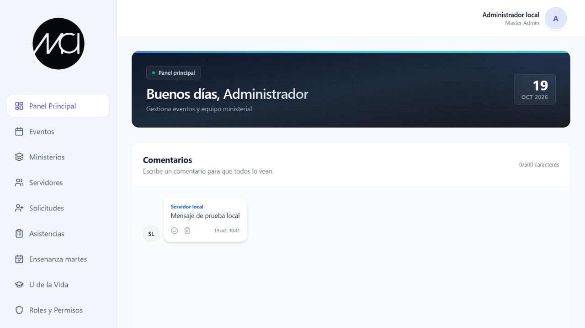

# MCI Servidores

Recuperación de `mcimachala-servidor`, publicado en <https://mcimachala-servidor.web.app/login>. La recuperación lee Firebase y Google Cloud; no despliega ni modifica la aplicación de producción.

El repositorio contiene 47 archivos de Hosting verificados por SHA-256, 28 copias legibles del JavaScript de la aplicación, un frontend editable que se vuelve a compilar y el paquete de fuentes realmente desplegado del backend con sus 30 exportaciones. Se recuperaron las reglas activas de Firestore y Storage, cinco índices compuestos, una configuración de índices de campo y los rewrites/cabeceras vigentes de Hosting.

El frontend ahora tiene una **reconstrucción nueva en JSX**, separada en pantallas, componentes, autenticación, hooks y servicios. Se reconstruyeron 3.632 expresiones JSX conservando la lógica publicada y sus contratos. **No se recuperaron los JSX/TSX originales ni el package.json original del frontend.** El backend sí incluye `src/index.ts`, package.json, lockfile y tsconfig descargados de Functions; ese archivo ya contenía CommonJS y `@ts-nocheck`. Los snapshots originales permanecen separados de los cambios de mantenimiento.

## Ejecutar y probar

Usa Node.js 22 para Functions y los emuladores; Node.js 24.11 o superior para las herramientas del frontend. También se necesita Java 21 para Firestore/Storage y Firebase CLI 15.34.0 o compatible.

```bash
npm ci
npm --prefix functions ci --ignore-scripts
npm run build
npm test
npm run test:recovery
```

Para iniciar los emuladores, instala Firebase CLI localmente o proporciona `FIREBASE_TOOLS_PATH` con la ruta de su archivo `lib/bin/firebase.js`. Establece `JAVA_HOME` si Java no está en el PATH. Ejecuta con Node 22:

```bash
npm run emulators
```

En otra terminal:

```bash
node scripts/seed-emulators.mjs
npm run dev
```

Abre <http://127.0.0.1:5176/login>. El usuario de prueba `recoveryadmin` y su contraseña **exclusivamente local** se definen en `scripts/seed-emulators.mjs`. Los datos son sintéticos. El proyecto demo se llama `demo-mci-servidores`; no reutiliza los usuarios ni los documentos de producción.

Para crear otro administrador demo con una contraseña elegida localmente, usa PowerShell 7. El comando solicita la contraseña oculta y pasa JSON por stdin; no la escribe en archivos ni en los argumentos del proceso:

```powershell
$localCredential = Get-Credential -UserName 'admin-local' -Message 'Credenciales nuevas solo para emuladores'
@{ username = $localCredential.UserName; password = $localCredential.GetNetworkCredential().Password; name = 'Administrador local' } | ConvertTo-Json -Compress | node scripts/create-local-admin.mjs
Remove-Variable localCredential
```

El helper fija `demo-mci-servidores`, Auth `127.0.0.1:9099` y Firestore `127.0.0.1:8080`, incluso si el entorno contiene otra configuración. No copies contraseñas de producción para esta prueba.

```bash
npm run test:integration
```

La compilación predeterminada conecta Auth, Firestore, Storage y Functions a emuladores locales. El servidor hace proxy de `/api/**` y `/comments/**` hacia `serverApi` local. Para una comparación que use servicios de producción se requiere `npm run build:frontend -- --production-services`; esto solo compila y no despliega. Las operaciones de esa variante pueden usar los datos reales.

La variante de sesión BFF se compila aparte con `npm run build:frontend -- --bff --out-dir dist-bff`. El frontend normal conserva los flags publicados. El registro automático del service worker está desactivado en demo; `--pwa-test` lo activa explícitamente para pruebas locales.

## Qué se conserva

| Carpeta/archivo | Procedencia y uso |
| --- | --- |
| `recovered/hosting/` | Publicación original descargada, sin modificar. |
| `recovered/readable-assets/` | 28 módulos formateados; equivalencia AST comprobada. |
| `frontend/src/`, `frontend/styles/` | JSX reconstruido y CSS editable derivados del despliegue; el build usa esbuild. |
| `frontend/RECONSTRUCTION.md` | Método de reconstrucción, organización y límites de las fuentes. |
| `frontend/public/firebase-messaging-*.js` | Worker y lógica nuevos reconstruidos; el archivo de lógica original no estaba publicado. |
| `recovered/backend-snapshots/` | Fuentes/manifiestos/compilado del backend antes de las correcciones locales. |
| `functions/` | Backend recuperado y correcciones de compatibilidad verificadas. |
| `recovered/cloud-config/` | Configuración pública exportada de la versión de Hosting. |
| `recovered/functions-inventory.json` | Nombres, generaciones, región y runtime de las 30 funciones. |
| `firestore.rules`, `storage.rules`, `firestore.indexes.json` | Reglas e índices activos recuperados. |
| `recovery/private/` | Metadatos administrativos, ZIP, capas de imágenes y logs; excluidos de Git. |
| `docs/RECOVERY-STATUS.md` | Procedencia, comprobaciones, cambios y límites pendientes. |
| `docs/FLOW-COVERAGE.md` | Cobertura por flujo y distinción entre emulación y simulación externa. |

`npm run verify` comprueba los bytes del snapshot. `npm run build:snapshot` conserva el modo anterior de copia exacta. `npm run build` ahora recompila el frontend editable y el backend TypeScript. El bundle de cámara conserva dos `require()` para Node en ramas que no se ejecutan en el navegador; se mantienen externos al recompilar. html2canvas conserva un aviso de `case` duplicado que ya estaba en el artefacto publicado.

## Validación y límites

El 29 de octubre de 2026 pasaron **138 pruebas Node**, **15 pruebas Python** y **41 comprobaciones de integración** con Auth, Firestore, Storage y Functions locales. Las pruebas incluyen servidor, JSX, cámara, Google, ciclo de notificaciones, Drive, consentimiento OAuth local, cifrado y controles HTTP, alta demo y service worker. El snapshot conserva sus 47 archivos con tamaño y SHA-256 verificados. La cobertura y los resultados están en `docs/FLOW-COVERAGE.md`, `docs/validation.json` y `recovery/flow-validation.json`.

Se corrigieron la persistencia de preferencias anidadas y la descarga de archivos del bucket demo. Se restauraron seis GET administrativos referenciados por la interfaz, con controles de rol y límites. Los reportes no inventan métricas ausentes y la ingestión de telemetría permanece desactivada. Functions conserva las 30 exportaciones. Las auditorías npm de frontend y Functions dieron **cero vulnerabilidades** el 29 de octubre de 2026; los overrides y su comprobación se explican en `functions/RECOVERY-CHANGES.md`.

Además de los emuladores, se completaron **Google Auth real y cierre de sesión** con una cuenta existente, y **captura con cámara física**, reinicio y liberación de sus pistas. La prueba Google usa una app Auth aislada con sesión en memoria; actualiza el último acceso de Auth, sin cargar perfiles, Firestore, Functions ni BFF. La prueba de cámara no conserva ni sube imágenes. Se confirmó también la recepción real de un mensaje FCM en el navegador tras renovar un registro rechazado. Las comprobaciones exactas y sus límites están en `docs/CAMERA-GOOGLE-VALIDATION.md` y `docs/NOTIFICATIONS-VALIDATION.md`.

**El respaldo real de Drive sigue pendiente del consentimiento del propietario.** La carpeta observada es de Mi unidad, mientras el runtime publicado usa una cuenta de servicio; se eligió conservar la carpeta mediante OAuth del propietario. Con autorización explícita se habilitaron Drive API y Picker API y se añadió solo Picker a la clave existente: los 26 destinos anteriores y las demás restricciones permanecen iguales. Esa configuración se verificó mediante lecturas independientes; no se cambiaron IAM, el cliente OAuth ni Hosting. El código comprueba el destino antes de leer Storage, verifica tamaño/checksum y protege la generación antes de borrar. Véanse `recovery/drive-oauth-cloud-validation.json` y `docs/DRIVE-READINESS.md`.

Se eligió **conservar Respaldo MCI con OAuth del propietario**. El flujo local reutiliza el cliente existente en su origen autorizado `http://localhost:5000`, pide únicamente `drive.file` y permite seleccionar la carpeta con Picker. Verifica la cuenta y la renovación antes de guardar una credencial protegida con DPAPI fuera de Git. `npm run drive:authorize -- --config recovery/private/drive-oauth/bootstrap.private.json` inicia la preparación; `npm run drive:test-owner` muestra un dry run sin credenciales ni red. La prueba real requiere consentimiento y la opción explícita de escritura, y solo crea/verifica/retira su propio TXT sintético. Requisitos y pasos: [`docs/DRIVE-OWNER-OAUTH.md`](docs/DRIVE-OWNER-OAUTH.md). La elección del método y los tests locales no se presentan como una autorización Drive ya concedida.

Las pruebas demo de FCM/Drive siguen usando adaptadores explícitos. GPS físico y entrega de Cloud Scheduler/PubSub permanecen pendientes. No se exportaron colecciones de producción, usuarios Auth ni objetos privados al repositorio. No se publicaron secretos ni se desplegó el código sobre la web publicada.


